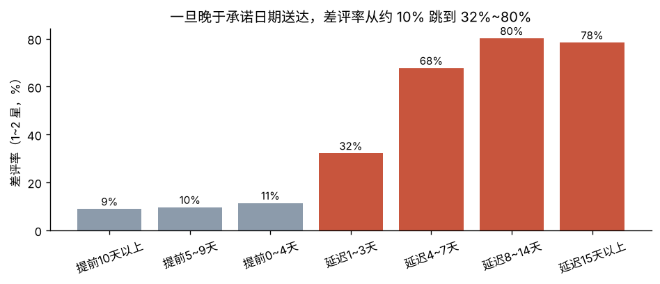

# Olist 电商差评归因与物流治理分析

基于巴西电商平台 Olist 的 8 张关联表（约 10 万订单），用 **SQL（多表 JOIN、CTE、窗口函数）+ Python** 回答一个业务问题：

> **差评从哪里来？平台应该优先治理什么？**

📄 **完整报告：[reports/REPORT.md](reports/REPORT.md)**

## 核心发现

1. **物流延迟是差评的头号来源**：延迟订单只占 6.7%，却贡献了 **32.5%** 的差评。差评率从准时订单的 9.3% 跳到延迟订单的 62.4%。用 Mantel-Haenszel 方法按州和品类分层后，差值依然在 +52.6 ~ +53.1pp，排除了地域和品类的混杂
2. **用户在意"守约"**：在承诺日期内送达时，差评率稳定在 9%~11%；只要晚到 1~3 天，差评率就跳到 32%
3. **根因主要在物流**：72% 的延迟订单卖家是按时发货的。延迟订单的运输时长中位数是 26 天，准时订单是 7 天
4. **卖家问题高度集中**：前 5% 的卖家贡献了 62% 的超时发货，但只承担 41% 的订单
5. **延迟对复购的影响不显著**：p = 0.21，最小可检测效应 0.78pp。我如实报告了这个"不显著"和它的局限



## 用到的技术

| 内容 | 位置 |
|---|---|
| 订单宽表（统一口径） | `sql/00_views.sql` |
| CTE + `LAG()` 计算 GMV 环比 | `sql/01_monthly_overview.sql` |
| `SUM() OVER ()` 计算占比 | `sql/03_late_root_cause.sql` |
| `RANK()` 排名 | `sql/04_state_late_rate.sql` |
| `ROW_NUMBER()` 取首单 + 自连接找下一次购买 + 观察窗口截断 | `sql/05_repurchase_after_first_order.sql` |
| `NTILE()` + 改良版 RFM 分层 | `sql/06_rfm_segments.sql` |
| 累计窗口 `ROWS UNBOUNDED PRECEDING` 做帕累托分析 | `sql/07_seller_late_pareto.sql` |
| Mantel-Haenszel 分层分析、两比例检验、MDE | `src/olist/stats.py` |
| **SQL 与 pandas 双实现交叉验证** | `tests/test_sql_consistency.py` |

> 交叉验证测试帮我发现过一个口径 bug：290 个用户在同一秒下了多笔订单（拆单），最初的写法把它们误算成了"复购"。

## 运行

```bash
pip install -r requirements.txt
python scripts/download_data.py   # 下载数据到 data/raw/
python scripts/build_db.py        # 导入 SQLite → data/olist.db
python analysis/run_analysis.py   # 运行全部 SQL、统计检验、出图
pytest -q
```

SQL 文件也可以直接在 DBeaver、DB Browser for SQLite 等工具里打开 `data/olist.db` 执行。先执行 `00_views.sql` 建宽表。

## 项目结构

```
├── sql/                  # 00 宽表 + 7 个分析查询
├── src/olist/            # 数据库工具、统计方法、绘图设置
├── analysis/run_analysis.py
├── tests/                # 统计函数单元测试 + SQL 口径一致性测试
├── scripts/              # 下载数据、建库
└── reports/              # 报告、图表、results.json
```

## 数据来源

[Brazilian E-Commerce Public Dataset by Olist](https://github.com/olist/work-at-olist-data)（MIT License），同一份数据也发布在 Kaggle 上。
