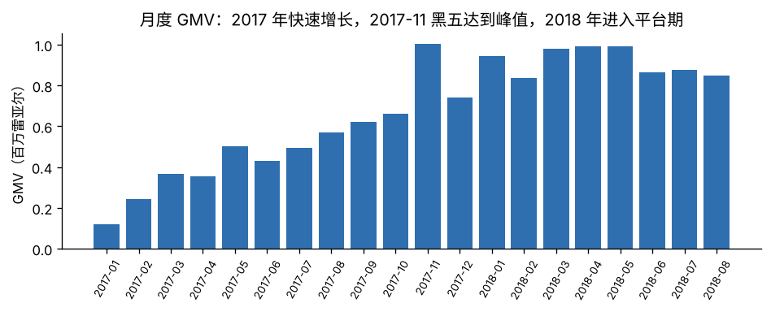
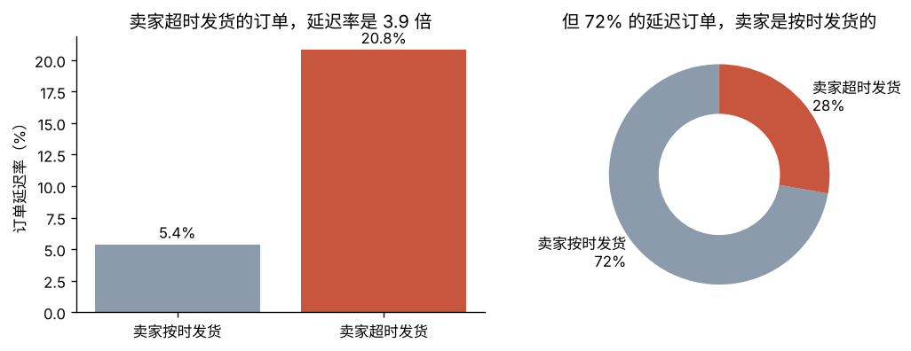
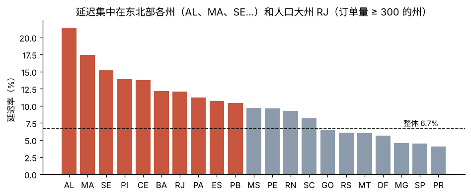
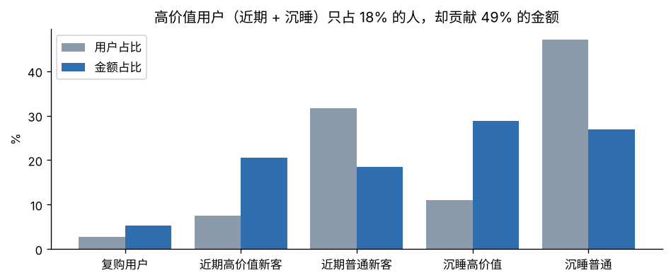
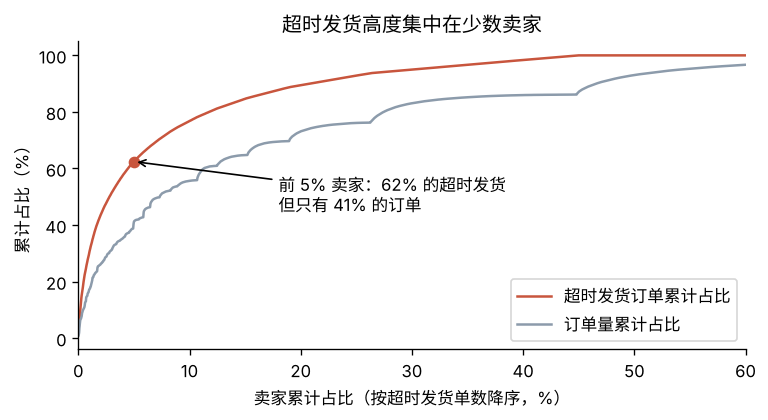

# Olist 电商差评归因与物流治理分析

> 所有数字都由 `sql/` 下的查询和 `analysis/run_analysis.py` 生成，结果存放在 `reports/results.json`。

## 一句话结论

**物流延迟是 Olist 差评的头号来源。**延迟订单只占 6.7%，却贡献了 32.5% 的差评。
如果这些订单的差评率能降到准时订单的水平，全平台差评可以减少约 **27.6%**。
延迟的主因是**物流运输**：72% 的延迟订单，卖家其实是按时发货的。
但卖家超时发货的问题**高度集中**：前 5% 的卖家贡献了 62% 的超时发货。所以治理要**两条线同时推进**。

---

## 0. 数据与口径

Olist 是巴西的电商平台，公开数据包含 2016-09 到 2018-10 约 10 万笔订单，分布在 8 张关联表里：订单、商品明细、支付、评价、用户、卖家、商品、品类翻译。

| 口径 | 定义 |
|---|---|
| 分析范围 | 已送达订单（`order_status = 'delivered'`，且有送达时间和交给物流的时间），共 96,469 单 |
| 延迟 | 按天比较，实际送达日期晚于承诺送达日期 |
| 卖家超时发货 | 交给物流的时间晚于平台规定的发货截止时间（订单内商品取最晚的截止时间） |
| 差评 | 1~2 星；一个订单有多条评价时取最后一条 |
| 用户 | `customer_unique_id`。`customer_id` 每下一单都会变，不能用来识别同一个用户 |
| 复购 | 首单之后，在**更晚的时刻**再次下单。同一秒被拆成多单的购物不算复购 |

所有分析都基于一张**已送达订单宽表** `dwd_delivered_orders`（见 `sql/00_views.sql`），保证口径一致。
`tests/test_sql_consistency.py` 用 pandas 从原始 CSV **独立重算**关键指标，与 SQL 结果逐一比对。
> 这个测试帮我发现过一个口径 bug：有 290 个用户在同一秒下了多笔订单。最初用 `LEAD()` 取"下一单"时，这些拆单被误算成了"0 天复购"。修正后，首单准时用户的复购率从 3.21% 变为 2.89%。

---

## 1. 业务概览

- 2017-01 到 2018-08 共 97,905 单（不含取消和缺货），商品 GMV 约 1,345 万雷亚尔，客单价 137 雷亚尔
- 2017 年快速增长，**2017-11 黑色星期五**达到峰值；2018 年进入平台期。2018-08 的 GMV 同比增长 49%

## 2. 延迟与评分：一旦晚到，差评率就跳一个台阶

| 送达时间（相对承诺日期） | 订单数 | 平均分 | 差评率 |
|---|---|---|---|
| 提前 10 天以上 | 61,523 | 4.32 | 8.9% |
| 提前 5~9 天 | 20,032 | 4.26 | 9.6% |
| 提前 0~4 天 | 7,888 | 4.12 | 11.4% |
| **延迟 1~3 天** | 1,852 | 3.29 | **32.1%** |
| 延迟 4~7 天 | 1,747 | 2.10 | 67.7% |
| 延迟 8~14 天 | 1,446 | 1.67 | 80.2% |
| 延迟 15 天以上 | 1,335 | 1.72 | 78.4% |

**发现**
- 在承诺日期以内送达时，差评率稳定在 9%~11%；**只要晚到 1~3 天，差评率就升到 32%，约是准时送达时的 3 倍**。用户在意的是"有没有守约"，而不只是"快不快"
- 准时订单的差评率是 9.27%，延迟订单是 62.43%，差了 **53.2 个百分点**

### 这个关系是不是被其他因素混淆了？

延迟订单更多出现在偏远州、大件品类，而这些州或品类的用户可能本来就更爱给差评。
所以我用 **Mantel-Haenszel 分层分析**，在同一个州（或同一个品类）**内部**比较延迟和准时订单，再合并结果：

| 控制的因素 | 合并后的差评率差值（95% CI） |
|---|---|
| 不控制 | +53.2pp |
| 按客户所在州（27 层） | **+52.6pp** [+51.4, +53.8] |
| 按商品品类（67 层） | **+53.1pp** [+51.9, +54.3] |

控制州和品类之后，差值几乎没变，说明**这个关系不是由地域或品类造成的**。
（这是观察数据，不能 100% 证明因果，但已经排除了两个最主要的混杂因素。）

### 差评归因

| | 数值 |
|---|---|
| 延迟订单占全部订单 | 6.7% |
| 延迟订单占全部差评 | **32.5%** |
| 延迟导致"多出来"的差评（延迟订单数 × 两组差评率之差） | 约 3,392 条 = 全部差评的 **27.6%** |

**情景测算**：如果把延迟率降低一半，并假设这部分订单的差评率回到准时水平，
全平台差评率会从 12.81% 降到 11.04%，平均分从 4.156 升到 4.223。

## 3. 延迟的根因：卖家，还是物流？

| | 订单占比 | 延迟率 | 占全部延迟订单 |
|---|---|---|---|
| 卖家按时发货 | 91.0% | 5.4% | **72.2%** |
| 卖家超时发货 | 9.0% | **20.8%** | 27.8% |

- 卖家超时发货的订单，延迟率是按时发货订单的 **3.9 倍**，说明卖家发货慢确实是风险因素
- 但从总量看，**72% 的延迟订单卖家都是按时发货的**，问题出在物流运输
- 延迟订单的运输时长中位数是 **26.2 天**，准时订单只有 7.0 天。卖家处理时长的差距小得多：3.1 天对 1.8 天

## 4. 地域：哪里最容易延迟

订单量 300 单以上的州里，延迟率最高的是东北部的 **AL（21.4%）、MA（17.4%）、SE（15.2%）**，是全国平均水平（6.7%）的 2 到 3 倍。
人口大州 **RJ**（里约热内卢，12,350 单）的延迟率也有 12.1%，单量大、影响面广。

## 5. 延迟会伤害复购吗？

| 首单 | 用户数 | 180 天复购率 |
|---|---|---|
| 准时 | 52,301 | 2.89% |
| 延迟 | 3,864 | 2.54% |

差值 −0.35pp，95% CI [−0.87, +0.17]，p = 0.21，**不显著**。

**怎么解读**
- Olist 的整体复购率本身就很低，不到 3%。延迟组只有 3,864 人，最小可检测效应约 **0.78pp**，相对差 27%
- 所以结论是：**没有证据表明延迟伤害了复购，但也不能排除存在中小幅度的负面影响**
- 延迟对**评分**的影响非常大，而评分会影响商品排序和新用户转化。所以即使复购上看不出影响，延迟的代价依然很高

> 为了避免"近期用户还没来得及复购"造成低估，只统计 2018-03-04 之前下首单的用户，保证每个人都有完整的 180 天观察期。

## 6. 用户分层（改良版 RFM）

标准 RFM 会对 R、F、M 各打 1~5 分。但 Olist **约 97% 的用户只买过一次**，F 几乎全是 1，对 F 打分没有意义。
所以我改成：F 看**是否复购**，R 看**最近一次购买是否在 180 天内**，M 看**金额是否排在前 20%**。

| 分层 | 用户占比 | 金额占比 | 客均金额 | 建议策略 |
|---|---|---|---|---|
| 复购用户 | 2.8% | 5.2% | 314 | 会员权益、专属客服，防流失 |
| 近期高价值新客 | 7.5% | 20.5% | 449 | **黄金窗口**：首单后 30 天内推送相关品类，促成第二单 |
| 近期普通新客 | 31.7% | 18.6% | 97 | 低门槛优惠券，培养复购习惯 |
| 沉睡高价值 | 10.9% | 28.8% | 435 | **召回优先级最高**：一个人的价值约等于 4.6 个普通用户 |
| 沉睡普通 | 47.1% | 26.9% | 94 | 低成本触达（邮件、Push），不投入高成本资源 |

高价值用户（近期 + 沉睡）只占 18% 的人，却贡献了约 49% 的金额。

## 7. 卖家治理：超时发货集中在少数卖家

| 卖家范围 | 卖家数 | 贡献的超时发货 | 承担的订单量 |
|---|---|---|---|
| 前 1% | 29 | 30.1% | 17.2% |
| **前 5%** | 148 | **62.4%** | 41.1% |
| 前 10% | 296 | 76.8% | 55.6% |

超时发货的集中度明显**高于**订单量的集中度：前 5% 的卖家承担 41% 的订单，却贡献了 62% 的超时发货。
这说明问题**不只是因为他们单量大**，他们的发货管理本身更差。比如超时发货最多的那个卖家，发货超时率达到 29.8%。

---

## 8. 建议（按优先级）

| 优先级 | 动作 | 依据 | 预期影响 |
|---|---|---|---|
| 1 | **物流线路治理**：优先优化东北部（AL、MA、SE、CE 等）和 RJ 的配送线路，考虑引入区域仓或更换承运商 | 72% 的延迟来自运输环节，这些州的延迟率是平均水平的 2 到 3 倍 | 延迟率减半 → 差评减少约 1,700 条，平均分 +0.07 |
| 2 | **重点卖家管控**：对超时发货最多的前 5%（148 家）卖家设置发货时效考核，并在后台预警 | 他们贡献了 62% 的超时发货；卖家超时发货的订单延迟率是 3.9 倍 | 成本低、见效快，管理对象只有 148 家 |
| 3 | **承诺时效动态化**：按线路给出更准的预计送达时间，对高风险线路适当放宽承诺 | 差评取决于"是否守约"：晚到 1~3 天的差评率是 32%，而提前送达稳定在 9%~11% | 降低"承诺落空"的比例 |
| 4 | **延迟补偿与主动告知**：预测会延迟时，提前通知用户并发放小额优惠券 | 延迟订单的差评率高达 62% | 需要用 A/B 实验验证效果 |
| 5 | **分层运营**：重点召回"沉睡高价值"用户，在新客首单后 30 天内促成第二单 | 18% 的高价值用户贡献约 49% 的金额 | 需要用 A/B 实验验证 |

## 9. 局限

- **观察数据，不是实验**：已经用分层控制了州和品类两个混杂因素，但仍可能存在未观测的混杂，比如商品质量
- **情景测算是理想化的**：它假设延迟订单变准时后，差评率能完全回到准时订单的水平
- 评价是用户自愿提交的，不评价的用户可能和评价的用户不同
- 数据截止到 2018 年，只能说明当时的情况
